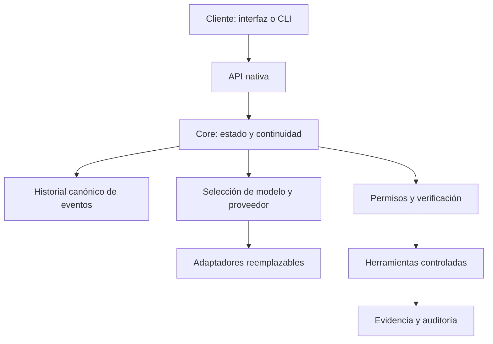

# Arquitectura pública resumida

Resumen nuevo basado en el README y ADRs locales; no copia la especificación privada completa. Las cajas representan responsabilidades de diseño. No certifican implementación completa ni despliegue.

El estado canónico pertenece al Core. Las sesiones y cachés de un proveedor son optimizaciones derivadas; su pérdida no debe impedir reconstruir la conversación. Los adaptadores aíslan particularidades de modelos y proveedores. Las acciones externas requieren una frontera de herramientas, permisos y auditoría.

La reconstrucción, el rechazo de caché incompatible y la independencia de proveedor aparecen como criterios M0. Su cumplimiento necesita pruebas del runtime; el ejemplo público solo ilustra una parte muy pequeña de esa idea.

Retos pendientes de validación pública: recuperación tras fallos, aislamiento efectivo de procesos, manejo de cuotas, compatibilidad real de proveedores y comportamiento durante sesiones prolongadas. No se afirma soporte universal.
